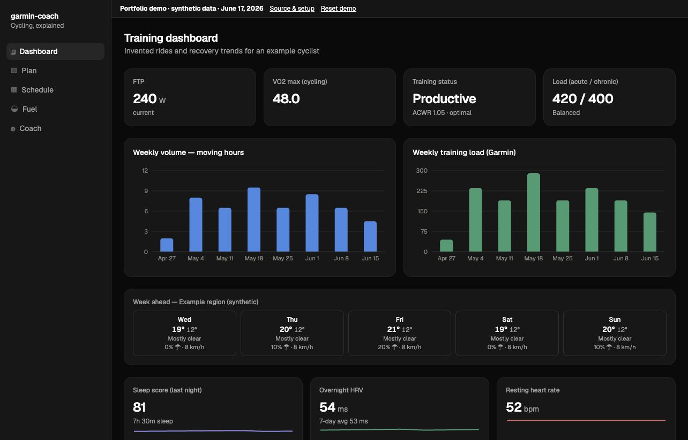
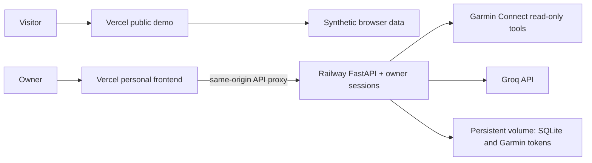

# Garmin Coach

A cycling dashboard and AI coach that turns Garmin activity data into understandable training context. Explore ride details, weekly load, recovery trends, a flexible schedule, and a timed fueling planner.

**[Try the public demo](https://garmin-coach-demo.vercel.app)** — synthetic data, no account or API key required. The personal app has authenticated, single-owner Garmin/Groq integration; it is deployed separately from the public demo.



## Try locally

Node.js 22+ and npm:

```sh
cd web
npm ci
npm run dev
```

Open the URL Vite prints. Demo mode is the default: no backend, Garmin credentials, or paid AI service is needed. The dataset has a fixed June 17, 2026 reference date so the schedule remains useful. Coach replies in the demo are clearly labeled authored examples. Use **Reset demo** to clear saved demo tracking, schedules and fueling plans.

## What it demonstrates

- React/TypeScript dashboard with ride streams, zones, training trends, and recovery data.
- Scheduling sessions around availability, with browser-local persistence.
- Deterministic fueling calculations and printable plans.
- A FastAPI backend sharing normalized, read-only Garmin tools with an MCP server.
- Groq coaching with streamed responses, validated tools, bounded requests, caching, and SQLite conversation history.
- Separate public-demo and private-data paths, server-enforced owner sessions, and deployment configuration for Vercel/Railway.

## Manual tracking

The new phone-first screens add workout templates, editable per-set logging, custom exercises and workouts, recoverable drafts, simple calorie/protein meals, reviewed history imports, gym scheduling, pound weigh-ins, bike minutes, and template-first exercise history. Today, Train, Schedule, Progress and Coach form the navigation; cycling tools remain accessible from Train. Basic tracking works without AI.

See [tracking setup and validation](docs/tracking.md) for private template provisioning, storage, draft recovery and backup/restore. Public examples are synthetic. These changes are deployed to the private app. The public demo remains on its earlier release. Actual iPhone Safari validation remains pending.

## Architecture



The demo does not contact the private API or AI provider. Personal endpoints require authentication even when accessed directly on Railway. Sessions expire after 12 hours and are revoked on logout or server restart. The first release supports one backend process and one owner.

## Personal setup

Python 3.12+:

```sh
python3 -m venv .venv
.venv/bin/python -m pip install -e '.[dev]'
```

See [.env.example](.env.example) for configuration. Environment files are **not loaded automatically**: export the variables or configure them in the hosting dashboard. Keep secrets out of `VITE_*` variables, which are public build inputs.

For an explicitly local session:

```sh
export GARMIN_COACH_ENV=local
.venv/bin/garmin-setup
.venv/bin/garmin-coach-web
```

In another terminal, run `cd web && VITE_APP_MODE=personal npm run dev`. Local mode binds the application entry point to loopback and intentionally bypasses owner login. Never expose this mode publicly. Hosted mode fails startup unless a strong `COACH_PASSWORD` and HTTPS `COACH_ORIGIN` are set.

Private athlete context defaults to `.local/athlete.md`; private plans to `.local/training/`, with `sessions.json` for the schedule. Start from the synthetic examples in `training/`. These private paths are ignored by Git. Garmin setup supports MFA; tokens are kept outside the public source.

## Deployment and validation

- [Deployment guide](docs/deployment.md): Vercel demo/personal projects, Railway volumes, secrets, reconnecting Garmin, backup and rollback.
- [Architecture and tradeoffs](docs/architecture.md)
- [Privacy review](docs/privacy-review.md): scan scope and unresolved history exposure.
- [Project roadmap](PROJECT_PLAN.md): current progress and remaining work.
- [Walkthrough](docs/walkthrough.md)

```sh
.venv/bin/python -m pytest -q
.venv/bin/ruff check src tests
.venv/bin/python -m mypy
cd web && npm run build && npm run lint
```

Tests use fixtures and mocked services, not real credentials. The demo adapter test exercises its data routes with network access forbidden. Browser checks cover visible navigation and interactions. No fabricated performance claims are used.

## Limits and data handling

Garmin integration uses the unofficial `python-garminconnect` library; upstream changes or rate limits can break it. Strava and workout uploads are not implemented. Coaching is advisory and must distinguish measured facts from interpretation; missing recovery data is not a readiness score.

The private coach sends your question, a bounded recent transcript, configured athlete/plan context, and selected Garmin tool results to Groq. It does not send Garmin login tokens. Review [Groq data controls](https://console.groq.com/docs/your-data) before enabling it. Free-tier quotas vary; the app reports exhaustion rather than switching to a paid provider. Hosting can still incur charges. Model quality and hosted streaming need live validation with the owner's configured accounts.

No license has been selected yet; public source visibility does not itself grant an open-source license.
