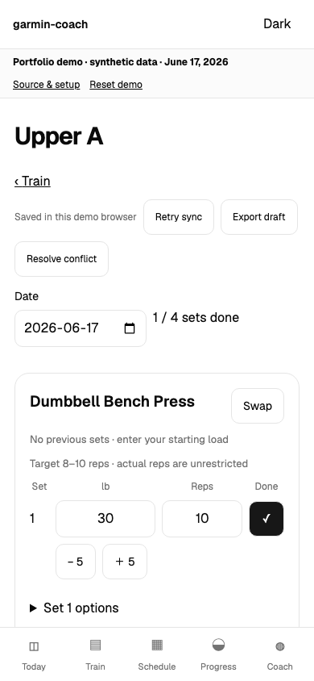
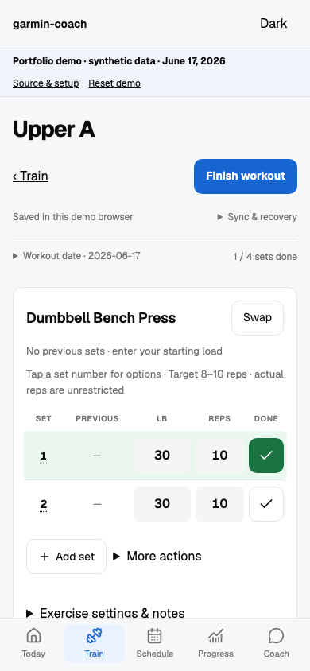

# Mobile training redesign

The existing React/Tailwind frontend now uses a shared blue action palette, neutral surfaces, green completed sets, and consistent Lucide navigation. Garmin chart tokens, route paths, tracking models, TrackingProvider, backend storage and API contracts were retained. No dependencies were added.

The audit covered the layout, tracking pages, tracking helpers/provider, current tracking documentation and browser tests. The current application also includes history imports and gym scheduling beyond the earlier repository description; those routes remain available. The [Hevy reference](https://www.hevyapp.com/features/track-workouts/) informed the compact set table, previous performance and secondary action placement.

Workout logging has a sticky Finish action, completion count, visible synchronization state, native modal exercise search and finish/discard confirmations, and a five-column set table. Tap the set number for load adjustments, warm-up, RIR and removal. Completion remains one tap. Previous values use `previousExercise` and match completed sets by warm-up/working ordinal; incompatible IDs, equipment and load conventions are excluded. Swap uses the existing preservation logic. Recovery/export/conflict controls remain under **Sync & recovery**.

Train defaults to the full routine library, with a suggested workout and direct start action, filters and expandable exercise previews. Today shows the current/suggested routine and recent completed workouts, separately from nutrition, weight and cycling. Progress shows history before selecting a comparison and provides consistent section buttons and a blue progression line. A resume banner links back to the active workout from other sections. Schedule and Coach inherit the shared theme and navigation; their business logic is unchanged.

## Changed files

- `web/src/pages/tracking/workout.tsx`, `set-row.tsx`, `dialog.tsx`: workout controls, reusable set row and native modal.
- `web/src/components/layout.tsx`, `web/src/index.css`, `web/src/pages/tracking/shared.tsx`: navigation, tokens, responsive styles, synchronization controls.
- `web/src/pages/tracking/train.tsx`, `today.tsx`, `progress.tsx`: routine library, daily overview and history.
- `web/check-tracking-browser.mjs`: configurable test origins and opening the actual recovery disclosure; existing behavioral assertions retained.
- `web/check-redesign-browser.mjs`: synthetic demo interaction, responsive/theme checks and screenshot capture.

## Validation

Executed successfully:

- `npm --prefix web run build` (existing large-bundle warning).
- `npm --prefix web run lint` (five warnings in unchanged files; no errors).
- `node web/check-demo.mjs`.
- `node web/check-tracking.mjs`.
- `.venv/bin/python -m pytest -q tests/test_tracking.py`: 8 passed; dependency deprecation warning.
- Tracking browser integration against disposable synthetic API: start, edit, completion, reload recovery, offline retention, retry, committed-write/lost-response retry, swap retaining completed sets, finish/rotation, progress, meal/weight/ride entries, 20 responsive route checks, and public demo API isolation.
- Redesign browser checks: 72 route/layout combinations at 320/375/390/430/768/1280px in both themes, picker Escape, completion reversal, add/remove sets, warm-up, RIR, add exercise, refresh recovery, discard cancellation/confirmation and zero public demo API calls or runtime errors.

The QA servers used alternate loopback ports and fresh directories under `/private/tmp/garmin-redesign-qa`; existing local servers and private records were not used. Browser testing uses Chromium touch emulation. Actual iPhone Safari keyboard, safe-area, home-screen relaunch and background behavior still require physical-device validation. No production deployment was performed; live Garmin and AI calls were not exercised.

## Screenshots

Captured with identical synthetic demo input at 390 × 844:

| Before | After |
| --- | --- |
|  |  |

Additional captures: [320px dark](screenshots/redesign/workout-320-dark.png), [desktop light](screenshots/redesign/workout-1280-light.png).

To run the additional UI check against the public demo Vite server:

```sh
node web/check-redesign-browser.mjs
# Optional origins and artifact destination:
DEMO_TEST_URL=http://127.0.0.1:5183 \
  BEFORE_TEST_URL=http://127.0.0.1:5175 \
  SCREENSHOT_DIR=/private/tmp/garmin-redesign-screenshots \
  node web/check-redesign-browser.mjs
```

`BEFORE_TEST_URL` is optional and should serve the original frontend with synthetic demo data. See `tracking.md` for provisioning the separate disposable personal API fixture; `TRACKING_TEST_URL` and `DEMO_TEST_URL` override the integration test's default origins. Never target private or production records.
